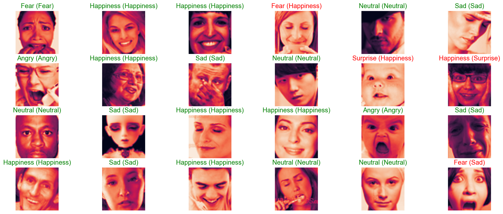
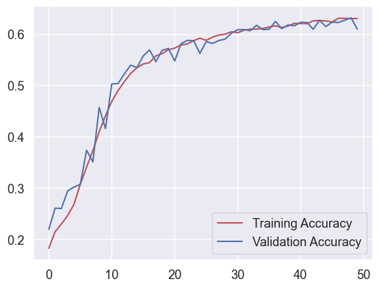
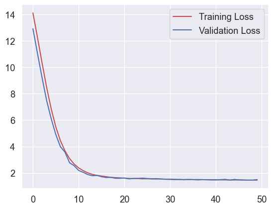

# Facial Emotion Recognition

A convolutional neural network that recognises **7 facial emotions** — Angry, Disgust, Fear, Happy, Sad, Surprise and Neutral — from 48×48 grayscale face images, trained from scratch on the FER-2013 dataset with TensorFlow / Keras.



<sub>Predictions on unseen test images — *predicted (actual)*, green = correct, red = wrong.</sub>

## Results

The final model reaches **61.8 % accuracy** on a held-out test set of 3,589 images. For reference, human accuracy on FER-2013 is roughly 65 %.

| Emotion | Precision | Recall | F1 | Test images |
|---|---|---|---|---|
| Happy | 0.917 | 0.791 | **0.849** | 963 |
| Surprise | 0.638 | 0.787 | 0.705 | 385 |
| Neutral | 0.492 | 0.663 | 0.565 | 585 |
| Angry | 0.520 | 0.563 | 0.540 | 492 |
| Disgust | 0.880 | 0.386 | 0.537 | 57 |
| Sad | 0.508 | 0.470 | 0.488 | 587 |
| Fear | 0.486 | 0.367 | 0.418 | 520 |
| **Macro avg** | 0.634 | 0.575 | 0.586 | 3,589 |

Happy and Surprise have distinctive features (smile, open mouth and raised brows) and are recognised well. Fear and Sad are the hardest; they are often confused with each other and with Neutral. Disgust is rare in the dataset (547 of 35,887 images), so its recall is low.

<p>
  
  
</p>

Training and validation curves track closely, so the model isn't overfitting. Accuracy plateaus around 62–63 % after about 40 epochs.

### Experiments

| # | Optimiser | Schedule | Test accuracy |
|---|---|---|---|
| 1 | Adam, lr 1e-4 | 30 epochs, early-stop patience 5 | 58.5 % |
| 2 | SGD, lr 1e-3 | diverged, stopped at epoch 5 | 21.3 % |
| 3 | Adam, lr 1e-4 | 50 epochs, early-stop patience 10 | **61.8 %** |

## Model

```
Input 48×48×1
→ Conv(32) → Conv(64) → BN → MaxPool → Dropout
→ Conv(128, 5×5) → BN → MaxPool → Dropout
→ 3 × [Conv(512) + L2 → BN → MaxPool → Dropout]
→ Flatten → Dense(256) → BN → Dropout → Dense(512) → BN → Dropout
→ Dense(7, softmax)
```

~5.8 M parameters. Training uses random shifts, zoom and horizontal flips for augmentation, categorical cross-entropy loss, and early stopping on validation accuracy with best-weight checkpointing.

## Repository structure

```
├── notebooks/
│   ├── 01_fer2013_cnn.ipynb                     # main pipeline: data → CNN → evaluation (with outputs)
│   └── 02_cnn_vs_resnet50v2_experiments.ipynb   # exploratory: custom CNN vs ResNet50V2 transfer learning
├── assets/                                      # figures used in this README
├── data/                                        # dataset goes here (not committed)
├── requirements.txt
└── LICENSE
```

## Getting started

```bash
git clone https://github.com/CarolDsillva/Facial-Emotion-Recognition.git
cd Facial-Emotion-Recognition
pip install -r requirements.txt
```

1. Download FER-2013 into `data/`. [`data/README.md`](data/README.md) explains how.
2. Open `notebooks/01_fer2013_cnn.ipynb` and run all cells. On a CPU each epoch takes about 3 minutes; a GPU is much faster.

The best model is saved as `best_model.keras`.

## Limitations and next steps

- **Input normalisation.** Pixels are fed in as raw 0–255 values, and batch normalisation does the heavy lifting. Scaling to 0–1 should stabilise training.
- **Validation augmentation.** The validation generator applies the same augmentation as training. Evaluating on un-augmented images would give a cleaner signal for early stopping.
- **Class imbalance.** Class weights or oversampling would help Disgust and Fear.
- **Transfer learning.** Notebook 02 sets up a ResNet50V2 fine-tuning experiment, but that run hasn't been completed yet.
- **Real-time inference.** The next step is to pair the model with OpenCV's Haar-cascade face detector for webcam predictions.

## Related

This model is the emotion-detection component of my emotion-based music recommendation app, [emuziek](https://github.com/CarolDsillva/Emotion-based-music-recommendation-system).

## License

[MIT](LICENSE) © Carol Dsilva. The FER-2013 dataset is subject to its own terms of use.
